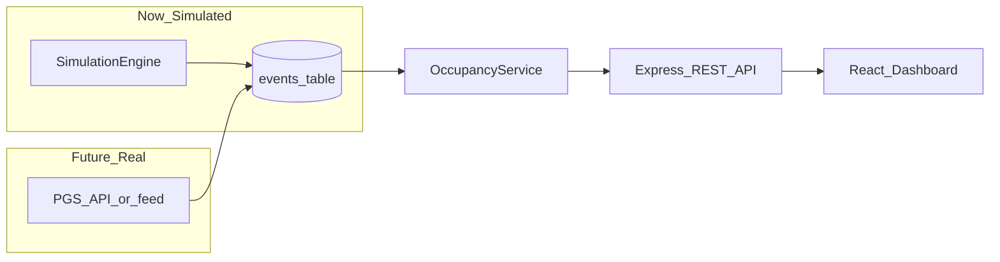
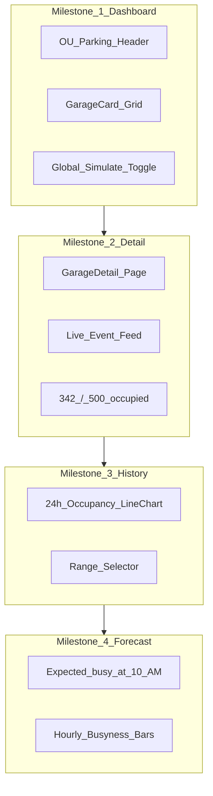

# OU Parking Occupancy Prototype — Project Plan

## Goal

Build a **demonstration-ready prototype** that shows OU Parking Services you understand their problem space and have a credible path from simulated data to real PGS integration — without connecting to any real systems yet.

The prototype should answer: *"If occupancy data were available, here's what students would see."*

---

## Recommended Tech Stack


| Layer              | Choice                                                  | Why (for you as a learning developer)                                                                                          |
| ------------------ | ------------------------------------------------------- | ------------------------------------------------------------------------------------------------------------------------------ |
| **Backend**        | Node.js + Express                                       | Minimal setup, huge tutorial ecosystem, easy REST APIs. Same language as frontend.                                             |
| **Database**       | SQLite via `better-sqlite3`                             | File-based — no Docker, no cloud DB. Stores garages, events, and future historical snapshots in one place. Portable for demos. |
| **Frontend**       | React + Vite                                            | Industry-standard UI library; Vite gives fast hot reload. Good Cursor/AI support.                                              |
| **Styling**        | Tailwind CSS                                            | Gets you a polished, modern UI quickly without writing lots of custom CSS. Important for the Parking Services demo.            |
| **Charts (later)** | Recharts                                                | React-native charting library; simple API for line/bar charts when you add history views.                                      |
| **Dev workflow**   | Two terminals: `npm run dev` in `/server` and `/client` | Keeps backend and frontend concerns separate — mirrors how a real PGS API integration would work later.                        |


### Deliberately **not** using (yet)

- **Next.js full-stack** — powerful, but mixes server/client concepts early and adds routing complexity before you need it.
- **PostgreSQL / cloud hosting** — overkill for a local prototype; adds setup friction.
- **WebSockets** — polling every few seconds is simpler and matches how many real parking systems expose data anyway.
- **Machine learning libraries** — forecast feature can start as rule-based patterns on simulated hourly averages; ML comes much later.
- **TypeScript** — optional upgrade after Milestone 1; JavaScript keeps the first milestone smaller while you're learning.

### Key architectural decision: event-sourced occupancy

Model occupancy as **entry/exit events** (not just a random number that changes):

```
occupancy = count(entries) - count(exits)   // clamp display at 0
```

This mirrors how camera/gate infrastructure actually works and means swapping simulated events for real PGS data later is a **data-source change**, not a logic rewrite.




---

## Folder Structure

Single repo, two apps — simple and easy to navigate:

```
OU/
├── README.md                 # How to run, project vision, milestone tracker
├── server/
│   ├── package.json
│   ├── .gitignore            # node_modules, data/
│   ├── data/                 # SQLite file (gitignored, created at runtime)
│   └── src/
│       ├── index.js          # Express app entry, CORS, routes mount
│       ├── db.js             # Schema init + connection
│       ├── seed.js           # OU garage names/capacities
│       ├── occupancy.js      # Business logic (counts, status, available)
│       ├── simulation.js     # Fake entry/exit event generator
│       └── routes/
│           ├── garages.js    # GET garages, GET garage by id
│           └── events.js     # POST events, GET recent events, sim start/stop
└── client/
    ├── package.json
    ├── vite.config.js        # Proxy /api → localhost:4000
    ├── index.html
    └── src/
        ├── main.jsx
        ├── App.jsx           # Router shell (add react-router-dom in Milestone 2)
        ├── api.js            # Fetch helpers for all endpoints
        ├── index.css         # Tailwind imports
        ├── pages/
        │   ├── Dashboard.jsx       # Milestone 1
        │   ├── GarageDetail.jsx    # Milestone 2
        │   └── History.jsx         # Milestone 3
        └── components/
            ├── GarageCard.jsx
            ├── StatusBadge.jsx
            ├── OccupancyBar.jsx
            └── EventFeed.jsx
```

**Why this structure:** Each future feature gets its own page/component folder. The backend `occupancy.js` and `simulation.js` stay stable while you add UI layers on top.

---

## Data Model (designed for all milestones)

`**garages**` — seeded once with real OU garage names


| Column         | Type       | Notes                       |
| -------------- | ---------- | --------------------------- |
| id             | INTEGER PK |                             |
| name           | TEXT       | e.g. "Adams Parking Garage" |
| capacity       | INTEGER    | e.g. 500                    |
| location_label | TEXT       | optional, for UI subtitle   |


`**events**` — the core table (Milestone 1+)


| Column     | Type       | Notes                      |
| ---------- | ---------- | -------------------------- |
| id         | INTEGER PK |                            |
| garage_id  | INTEGER FK |                            |
| event_type | TEXT       | `'entry'` or `'exit'`      |
| created_at | TEXT       | ISO timestamp, default now |


`**occupancy_snapshots**` — added in Milestone 3


| Column      | Type       | Notes                               |
| ----------- | ---------- | ----------------------------------- |
| id          | INTEGER PK |                                     |
| garage_id   | INTEGER FK |                                     |
| occupancy   | INTEGER    | recorded count at snapshot time     |
| recorded_at | TEXT       | e.g. every 5 min via background job |


Snapshots power historical charts and later forecast features without re-querying millions of raw events.

---

## Business Logic (shared across all milestones)

These rules should live in `[server/src/occupancy.js](server/src/occupancy.js)` and never be duplicated in the frontend:

- **Occupancy** = entries − exits (all-time); display clamped at `max(0, raw)`
- **Available** = `max(0, capacity − occupancy)`
- **Percent occupied** = `round(occupancy / capacity * 100)`
- **Status badge:**
  - `full` — occupancy ≥ capacity
  - `filling up` — available spaces ≤ 20% of capacity (but not full)
  - `available` — available spaces > 20% of capacity

Occupancy **can exceed capacity internally** (cars enter after "full") — realistic for demo conversations with Parking Services.

---

## API Surface (grow incrementally)

### Milestone 1 (build first)


| Method | Endpoint                           | Purpose                                                   |
| ------ | ---------------------------------- | --------------------------------------------------------- |
| GET    | `/api/garages`                     | List all garages with live occupancy state                |
| GET    | `/api/garages/:id`                 | Single garage occupancy state                             |
| POST   | `/api/garages/:id/events`          | Manually record entry/exit (for testing)                  |
| GET    | `/api/garages/:id/events?limit=20` | Recent events, newest first                               |
| POST   | `/api/garages/:id/simulate/start`  | Start fake event stream (2–5s interval, 60/40 entry/exit) |
| POST   | `/api/garages/:id/simulate/stop`   | Stop fake event stream                                    |


### Milestone 2

- Same endpoints; frontend adds garage detail route using `GET /api/garages/:id` + events feed

### Milestone 3


| Method | Endpoint                             | Purpose                                    |
| ------ | ------------------------------------ | ------------------------------------------ |
| GET    | `/api/garages/:id/history?range=24h` | Hourly occupancy snapshots for charts      |
| POST   | `/api/admin/snapshot`                | Trigger or cron-record snapshot (internal) |


### Milestone 4


| Method | Endpoint                              | Purpose                                             |
| ------ | ------------------------------------- | --------------------------------------------------- |
| GET    | `/api/garages/:id/forecast?day=today` | Simulated hourly predictions from snapshot patterns |


---

## UI Vision (phased)




**Design direction for the demo:** Clean white/dark-neutral layout, OU crimson (`#841617`) as accent color, large occupancy numbers, color-coded status badges (green/yellow/red), progress bars on each garage card. Should look like a real campus utility app, not a class homework page.

---

## Development Milestones (recommended order)

### Milestone 1 — **Multi-Garage Live Dashboard** (build this first)

**Scope:** Prove the full data loop works with multiple garages and looks demo-ready.

Deliverables:

- Repo scaffold (`/server` + `/client`, README with run instructions)
- SQLite schema + seed **4–6 real OU garage names** with realistic capacities
- Occupancy business logic + simulation engine (per-garage)
- REST API (endpoints listed above)
- Dashboard page: grid of `GarageCard` components showing name, `342/500`, percent bar, status badge
- Poll `GET /api/garages` every 3 seconds
- "Start/Stop Simulation" button (global or per-garage)
- Tailwind styling with OU-themed accent color

**Why this first:** It's the smallest slice that is **impressive in a meeting** — multiple garages updating live answers the core student problem immediately. Everything else (detail pages, charts, forecasts) builds on this foundation.

**Estimated effort:** 1–2 focused sessions with Cursor.

---

### Milestone 2 — Garage Detail Page

- Add `react-router-dom`
- Click a garage card → `/garages/:id` detail view
- Large occupancy display, event feed, per-garage sim controls
- Back navigation to dashboard

---

### Milestone 3 — Historical Occupancy Charts

- Background job records `occupancy_snapshots` every 5 minutes while sim runs
- Seed a day of synthetic historical data on first run (so charts aren't empty in demos)
- History page/tab with Recharts line chart (24h / 7d toggle)
- Shows the *concept* of trend analysis to Parking Services

---

### Milestone 4 — Simulated Forecast

- Compute average occupancy by hour-of-day from snapshots
- Display messages like: *"Usually busiest 9–11 AM"* and *"Best time to park: after 2 PM"*
- Clearly label as **simulated prediction** in the UI
- No ML — simple averages are enough for prototype credibility

---

## What to Say in the Parking Services Meeting

The prototype demonstrates you understand:

1. **The student-facing problem** — no public occupancy visibility today
2. **Their existing infrastructure** — PGS already tracks this internally; your app is the public layer
3. **A realistic integration path** — your API accepts events; their system would feed events instead of the simulator
4. **Future value** — historical storage and pattern-based predictions (Milestones 3–4 previews)

Questions to bring to the meeting (informed by your architecture):

- Does PGS expose an API, webhook, or database view?
- Is data per-garage entry/exit counts, or aggregate occupancy only?
- Is historical data retained, and for how long?
- Are there licensing/privacy constraints on making data public?

---

## First Milestone — Concrete Build Checklist

When you're ready to implement Milestone 1, we'll build in this order:

1. Scaffold `server/` — Express, better-sqlite3, cors; `db.js` schema; `seed.js` with OU garages
2. Implement `occupancy.js` + `simulation.js`
3. Wire REST routes in `routes/garages.js` and `routes/events.js`
4. Scaffold `client/` — Vite + React + Tailwind; Vite proxy to port 4000
5. Build `Dashboard.jsx`, `GarageCard.jsx`, `StatusBadge.jsx`, `OccupancyBar.jsx`
6. Add 3-second polling + simulation controls
7. Write root `README.md` with setup steps and project vision

**Seed garages to use (verify names/capacities with OU Parking Services later):**

- Adams Parking Garage
- Walker Parking Garage
- Elm Parking Garage
- Jenkins Parking Garage
- Lloyd Noble Center Parking

Capacities can be placeholder values (e.g. 300–800) until you get real numbers from Parking Services.